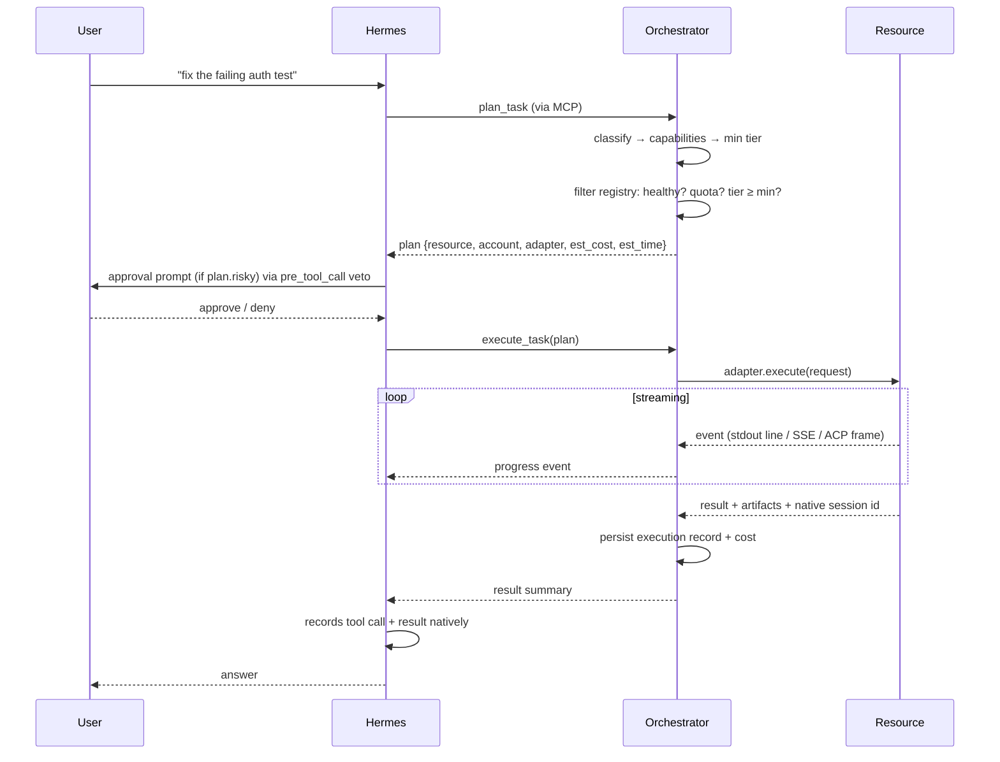
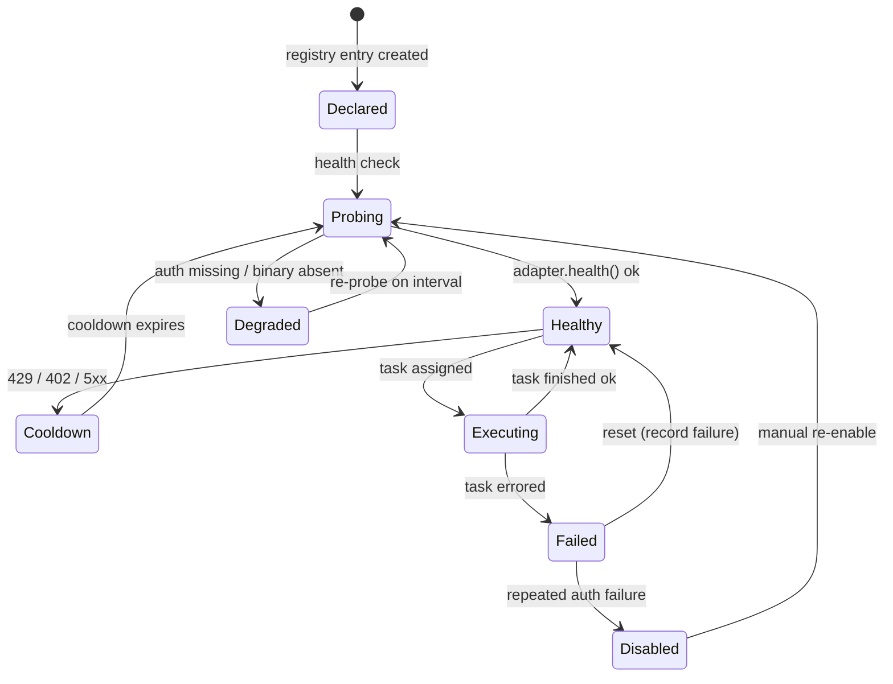

# 05 — Recommended System Architecture

**Status:** research-backed proposal, awaiting approval. Nothing here is implemented.
**Date:** 2026-11-09

---

## 0. The one-paragraph version

The current spec builds an orchestrator that re-implements task lifecycle, multi-account
rotation, fallback, parallel execution, checkpointing and a verification/rework loop — **all of
which Hermes already ships** (credential pools, fallback providers, Kanban, delegation, hooks).
The orchestrator should therefore be much smaller than currently specified. Its irreducible job is
**resource intelligence**: know what LLM APIs, coding CLIs and accounts exist, know which are
healthy and what each can do, and pick the smallest capable one. Hermes owns the conversation,
the task lifecycle and the user interface.

Concretely: the orchestrator becomes a **resource registry + router + adapter layer** that Hermes
reaches through **MCP** (one config entry, no Hermes source modification) and whose long-running
work rides on **Kanban worker lanes** (the documented seam for "a CLI worker that wraps Codex /
Claude Code / OpenCode"). The spec's "Account Manager", "Task Scheduler", "Checkpoint & Recovery"
and "Verification Engine" components are **deleted from the spec**, not implemented.

---

## 1. Architecture diagram

```mermaid
flowchart TB
    subgraph hermes["HERMES — primary interface (unchanged)"]
        UI["CLI / TUI / Desktop / Telegram"]
        AGENT["AIAgent core"]
        MCP["MCP client<br/>tools/mcp_tool.py"]
        POOL["Credential pools<br/>multi-key rotation"]
        FB["Fallback providers<br/>cross-provider failover"]
        KANBAN["Kanban board<br/>~/.hermes/kanban.db"]
        DELEG["delegate_task<br/>parallel subagents"]
        HOOK["Plugin hooks<br/>pre_tool_call veto"]
        UI --> AGENT
        AGENT --> MCP
        AGENT --> POOL
        AGENT --> FB
        AGENT --> KANBAN
        AGENT --> DELEG
    end

    subgraph orch["AI ORCHESTRATOR — resource intelligence layer"]
        MCPTOOLS["MCP server<br/>plan / execute / list_resources /<br/>get_execution / resume"]
        REG["Resource Registry<br/>declared + observed state"]
        ROUTER["System 1 Router<br/>classify → capability match →<br/>select smallest capable"]
        ACC["Account Health<br/>quota, rate limits, cooldowns"]
        ADAPT["Adapter Layer"]
        STORE[("Execution Store<br/>SQLite")]
        MCPTOOLS --> ROUTER
        ROUTER --> REG
        ROUTER --> ACC
        ROUTER --> ADAPT
        ADAPT --> STORE
    end

    subgraph res["RESOURCES"]
        API["LLM API adapters<br/>NVIDIA NIM · OpenRouter · …"]
        CLI["Coding CLI adapters<br/>OpenCode · Kiro · Claude Code · Pi · Cline"]
        BROWSER["Browser AI adapters<br/>DEFERRED — out of MVP"]
    end

    MCP <-->|"stdio or HTTP/SSE<br/>config.yaml mcp_servers:"| MCPTOOLS
    KANBAN -->|"plugin spawn_fn(task, workspace, board)"| ADAPT
    HOOK -->|"approval veto"| MCPTOOLS
    ADAPT --> API
    ADAPT --> CLI
    ADAPT -.-> BROWSER

    style hermes fill:#1a3a2a,stroke:#4ade80
    style orch fill:#2a1f3a,stroke:#a78bfa
    style res fill:#3a2a1a,stroke:#fbbf24
```



---

## 2. Component responsibilities

### 2.1 Owned by Hermes — do not rebuild

| Capability | Hermes mechanism | Verified source |
|---|---|---|
| Conversation, history, compression | `state.db` (SQLite + FTS5), `hermes_state_compression.py` | `07-hermes-integration.md:286-290` |
| Multi-account API key rotation | Credential pools — `round_robin`, `least_used`, `fill_first`, `random` | credential-pools doc |
| Cross-provider failover | `fallback_providers:` list, reset-aware benching | fallback-providers doc |
| Task lifecycle, parallel dispatch, workspaces | Kanban — 14 `kanban_*` tools, `~/.hermes/kanban.db` | kanban doc |
| Verification → rework loop | Kanban review: `kanban_request_review` → `kanban_request_changes` | kanban-worker-lanes doc |
| Crash / timeout / give-up reaping | Kanban kernel: `crashed` / `gave_up` / `timed_out` | kanban-worker-lanes doc |
| Approval UI + prompt | `pre_tool_call` hook veto, `tools/approval.py` | `plugins.py:1912-1984` |
| Parallel subagents | `delegate_task` + delegation-provider plugin interface | `agent/delegation_provider.py` |
| Provider preference routing | `provider_routing.sort: price|throughput|latency` | provider-routing doc |
| Skills, memory, profiles | `tools/skills_tool.py`, `tools/memory_tool.py`, `profiles.py` | `07-hermes-integration.md:317-329` |

### 2.2 Owned by the orchestrator — build these

| Component | Responsibility | Why it is not Hermes's job |
|---|---|---|
| **Resource Registry** | Declare every LLM API, coding CLI, browser service and account. Hold *declared* config (endpoint, model, cost, limits) separately from *observed* state (quota left, last error, cooldown). | Hermes's credential pools rotate keys for one provider; they know nothing about Kiro CLI accounts or which model has which capability. |
| **Capability Model** | Map each resource to an ordered capability profile: `strength_tier`, `context_window`, `cost_per_1k`, `supports_tools`, `supports_streaming`, `supports_resume`, `capabilities[]`. | This is what makes "smallest capable" computable. |
| **System 1 Router** | Classify the task → determine required capabilities and a minimum tier → filter the registry → pick the cheapest/fastest resource that clears the bar → emit a plan. | Hermes routes *providers* for a model. The orchestrator routes *across model and non-model resources* by task shape. |
| **Account Health** | Track per-account quota, rate-limit windows, cooldowns and recent failures. Feed the router's availability filter. | Hermes's pools rotate on 429; they do not know that Kiro account 2 is in a browser-login state. |
| **Adapter Layer** | One thin adapter per resource: `capabilities()`, `execute(request) -> AsyncIterator[Event]`, `health()`, `resume(session_id)`. | Nothing existing unifies `opencode serve` (HTTP), `kiro-cli` (subprocess/ACP) and an HTTP LLM API. |
| **Execution Store** | SQLite: execution records, checkpoints, artifacts index, cost ledger. | Hermes's `state.db` is the *conversation*; the orchestrator's store is *resource execution*. |
| **MCP Server** | Expose `plan`, `execute`, `list_resources`, `get_execution`, `resume_execution`, `list_accounts` to Hermes. | The registration surface. |

### 2.3 Explicitly removed from the spec

| Was | Why it is removed |
|---|---|
| Account Manager (own implementation) | Hermes credential pools already rotate same-provider keys. The orchestrator keeps only *capability + health* metadata per account. |
| Task Scheduler | Kanban owns queueing, parallelism, workspaces, retries and reaping. |
| Checkpoint & Recovery | Kanban owns task-level recovery. The orchestrator keeps only *resource-level* checkpoints (which CLI session id, which worktree). |
| Verification Engine | Kanban's review/rework loop is exactly this, and it already has a reviewer model + a `sdlc-review` skill. |
| Browser AI phase | Out of MVP (§7). |

---

## 3. Integration pattern (the recommended one)

### 3.1 Two surfaces, both supported, no Hermes source modification

**Surface A — MCP server (the interactive path).**

```yaml
# ~/.hermes/config.yaml
mcp_servers:
  orchestrator:
    url: "http://127.0.0.1:9100/mcp"
    headers:
      Authorization: "Bearer ${ORCHESTRATOR_API_KEY}"
    tools:
      include: ["plan_task", "execute_task", "list_resources", "get_execution"]
```

Hermes probes the server at startup and registers the tools under toolset `mcp:orchestrator`
(`tools/mcp_tool_discovery.py`). Filters are native (`tools.include` / `tools.exclude`). Auth
headers resolve `${ENV_VAR}` from `~/.hermes/.env` (`mcp_config.py:327-342`).

Verified: **Hermes has no MCP *server*.** The only direction that works is orchestrator-as-server,
Hermes-as-client — which is exactly the direction this project needs.
(`07-hermes-integration.md:221-234`)

**Surface B — Kanban worker lane (the long-running path).**

A Hermes plugin registers a non-spawnable assignee whose `spawn_fn(task, workspace, board=board)`
launches the orchestrator's CLI adapter for that card:

```python
# ~/.hermes/plugins/orchestrator-lane/plugin.yaml
manifest_version: 1
name: orchestrator-lane
kind: kanban-lane
version: 0.1.0
requires_hermes: ">=0.22.2"
description: Route Kanban cards to the ai-orchestrator resource router
license: MIT
capabilities:
  provides_tools: []
  provides_hooks: []
  provides_middleware: []
  requires_env: []
```

```python
# __init__.py
def register(ctx):
    def spawn_fn(task, workspace, board=None):
        # Ask the orchestrator which resource can do this task, then run it.
        plan = orchestrator_client.plan(task.description, workspace=workspace)
        return orchestrator_client.run(plan, workspace=workspace)  # returns a PID

    ctx.register_kanban_worker_lane(assignee="orchestrator", spawn_fn=spawn_fn)
```

The worker MUST end its run with exactly one of `kanban_complete`, `kanban_request_review`, or
`kanban_block` — otherwise the kernel treats it as crashed and reapies the circuit breaker.

**Why both?** MCP is the interactive path (user asks → one tool call → result). Kanban is the
long-running path (minutes-to-hours, needs workspaces, parallel workers, reviewer gates,
crash recovery). The spec's Phase 5 "session continuity" is what these two together buy: the
conversation sees the tool call, the board holds the durable record.

### 3.2 Why not the other surfaces

| Surface | Rejected because |
|---|---|
| **Plugin tool only** | Blocks one tool call for the whole task. No parallel fan-out, no workspaces, no reviewer gate, no crash recovery. Good for a 5-second "pick a model" call; bad for a 20-minute coding task. |
| **Delegation provider** | The route vocabulary is `model`/`provider`/`base_url`/`profile` — it selects *where a Hermes child runs*. It cannot express "run Kiro CLI account 2 in workspace W". A delegation provider picks a route, not an arbitrary execution backend. (`agent/delegation_provider.py:35`) |
| **TUI gateway JSON-RPC** | Drives Hermes *from* an external client — the opposite direction. |
| **ACP / API server** | Same: these make Hermes the server. |
| **Writing to `state.db` directly** | The brief forbids it absent proof of a supported method, and none exists. |

---

## 4. Task lifecycle



**Escalation** (if the result fails verification): the orchestrator re-plans with a higher
`strength_tier` — or, for same-provider quota exhaustion, hands back a signal that Hermes's
credential pool should rotate. Escalation budget is capped by a per-task spend limit.

---

## 5. Resource lifecycle



Key point: **the registry stores declared config and observed state separately.** The current
spec mixes them in one YAML object (`limits:` next to `state.quota_remaining`), which cannot stay
accurate if the file is static.

---

## 6. Session lifecycle and continuity

The current spec's requirement — *"everything stays accessible from the same Hermes
conversation"* — has no supported mechanism (verified twice: `07-hermes-integration.md:292-315`,
and independently in `parts/00-hermes-surface-audit.md`).

**The reframed design:**

| Layer | Owner | Contains |
|---|---|---|
| Conversation | Hermes (`state.db`) | the user's prompts, the tool calls, the results |
| Execution record | Orchestrator (SQLite) | plan, resource, account, adapter, timing, cost, artifacts, native session id, error class |
| Task lifecycle | Hermes (Kanban) | card, assignee, workspace, state, review verdict, crash history |
| Native CLI session | The CLI itself | Kiro `--resume-id`, OpenCode `--session`, Claude Code `--resume` |

The user "continues from the same conversation" because the **conversation references the task**,
and the task references the execution. Hermes owns the transcript; the orchestrator owns the
resource-level truth and can reconstruct any execution from its own store even after Hermes
compressed or the CLI died.

**Resume, concretely:**
- Kiro: record `--resume-id` → later `kiro-cli chat --resume-id <id>`
- OpenCode: record `--session` → later `opencode --session <id>` (or `opencode serve` + SDK)
- Claude Code: record the session id → later `claude --resume <id>`
- LLM APIs: stateless; resume = re-issue with the recorded context bundle

---

## 7. Browser-based AI — deferred, not built

The brief asks whether browser-based AI belongs in the MVP. **It does not.** Reasons, all
evidence-backed:

1. **ToS exposure.** The prior analysis in this workspace concluded that bridging ChatGPT/Claude
   web sessions is *"against the Terms of Service"*, *"unstable"*, and *"not a viable production
   approach"* (`multi-account-cli-isolation-analysis.md` §2.6, §5). The spec's own OQ6 leaves
   this unresolved.
2. **Captcha handling is the wrong feature.** `phases/phase-4-browser.md:21` lists "Handle CAPTCHA
   / verification flows" as a work item. Building CAPTCHA-solving is the clearest possible signal
   of adversarial automation, and it would be the project's most legally exposed component.
3. **No upside for the NVIDIA case.** The NVIDIA Build playground fronts an API the orchestrator
   can already call directly with `NVIDIA_API_KEY`. Driving a browser to reach an API you hold
   the key for is strictly worse — slower, more fragile, more code, and it adds a ToS question
   with no upside.
4. **Every CLI in scope already has a sanctioned API.** OpenCode has `opencode serve` + an SDK;
   Kiro, Pi, Cline and Claude Code all have headless modes. Browser automation is only needed to
   reach services with *no* API — which is precisely the case with the worst legal posture.

If it returns later, the constraints are: Playwright only, per-purpose isolated profiles, **no
CAPTCHA solving**, only services whose terms permit automation, and never as a quota or
subscription bypass.

---

## 8. Data model (SQLite)

```sql
-- Declared resource identity and capability profile
CREATE TABLE resource (
  id                TEXT PRIMARY KEY,      -- e.g. "nvidia-nim:minimax-m3.1-flash"
  type              TEXT NOT NULL,         -- llm_api | coding_cli | browser_service
  provider          TEXT NOT NULL,
  model_or_command  TEXT,
  adapter           TEXT NOT NULL,         -- adapter class name
  strength_tier     INTEGER NOT NULL,      -- 1..10, ORDERED. This is what makes "smallest capable" computable
  context_window    INTEGER,
  cost_in_per_mtok  REAL,
  cost_out_per_mtok REAL,
  capabilities      TEXT NOT NULL,         -- JSON array
  supports_tools    INTEGER NOT NULL DEFAULT 0,
  supports_streaming INTEGER NOT NULL DEFAULT 0,
  supports_resume   INTEGER NOT NULL DEFAULT 0,
  declared          TEXT NOT NULL          -- JSON: endpoint, env refs, extra flags
);

-- One row per usable credential/account for a resource
CREATE TABLE account (
  id            TEXT PRIMARY KEY,         -- e.g. "nvidia-nim:minimax-m3.1-flash:acct-work"
  resource_id   TEXT NOT NULL REFERENCES resource(id),
  auth_ref      TEXT NOT NULL,            -- env:VAR_NAME or keychain:ref — NEVER the secret itself
  isolation     TEXT NOT NULL,            -- JSON: env overrides + config dir for this account
  enabled       INTEGER NOT NULL DEFAULT 1,
  UNIQUE(resource_id, auth_ref)
);

-- Observed state, updated at runtime. Separate from `resource` on purpose.
CREATE TABLE account_state (
  account_id        TEXT PRIMARY KEY REFERENCES account(id),
  available         INTEGER NOT NULL DEFAULT 1,
  cooldown_until    REAL,                  -- unix ts
  quota_remaining   REAL,                  -- NULL = unknown/unreported
  rate_limit_rpm    REAL,
  last_error_class  TEXT,                  -- 429 | 402 | 401 | 5xx | timeout | auth_required
  last_used_at      REAL,
  consecutive_failures INTEGER NOT NULL DEFAULT 0
);

CREATE TABLE execution (
  id             TEXT PRIMARY KEY,
  task_ref       TEXT,                    -- Kanban card id or Hermes tool_call id
  request        TEXT NOT NULL,
  resource_id    TEXT NOT NULL,
  account_id     TEXT NOT NULL,
  adapter        TEXT NOT NULL,
  status         TEXT NOT NULL,           -- planned|running|succeeded|failed|cancelled
  native_session_id TEXT,                 -- kiro --resume-id / opencode --session / claude --resume
  workspace      TEXT,
  started_at     REAL,
  ended_at       REAL,
  cost_usd       REAL,
  error_class    TEXT,
  output_digest  TEXT
);

CREATE TABLE artifact (
  execution_id TEXT NOT NULL REFERENCES execution(id),
  path        TEXT NOT NULL,
  kind        TEXT,
  bytes       INTEGER,
  sha256      TEXT
);

CREATE TABLE checkpoint (
  execution_id TEXT PRIMARY KEY REFERENCES execution(id),
  state        TEXT NOT NULL,             -- JSON snapshot of adapter-specific resume state
  created_at   REAL NOT NULL
);

CREATE TABLE cost_ledger (
  id          INTEGER PRIMARY KEY,
  execution_id TEXT NOT NULL REFERENCES execution(id),
  account_id   TEXT NOT NULL,
  ts           REAL NOT NULL,
  in_tokens    INTEGER, out_tokens INTEGER,
  cost_usd     REAL NOT NULL
);
```

**Indexes:** `account_state(cooldown_until)`, `execution(task_ref)`, `execution(status)`,
`resource(type, strength_tier)`.

**Why SQLite:** the brief says *"Do not introduce Kubernetes, Kafka, Redis or other infrastructure
unless the actual requirements justify it."* SQLite satisfies every stated requirement — durable,
queryable, zero extra services, single-writer semantics that match a single orchestrator process —
and it matches Hermes's own choice (`state.db`, `kanban.db`). PostgreSQL (proposed in the brief)
and Redis (proposed in OQ2) are unjustified at this scale.

---

## 9. Communication flow summary

| From | To | Mechanism | Auth |
|---|---|---|---|
| Hermes | Orchestrator | MCP over stdio or HTTP/SSE | `Authorization: Bearer ${ORCHESTRATOR_API_KEY}` |
| Hermes | Orchestrator | Kanban lane `spawn_fn(task, workspace, board)` | in-process plugin |
| Orchestrator | LLM API | HTTPS REST (provider-specific) | env ref → resolved at call time |
| Orchestrator | OpenCode | HTTP (`opencode serve`) or SDK | per-account config dir |
| Orchestrator | Kiro CLI | subprocess (`--no-interactive --output-format stream-json`) or ACP stdio | `KIRO_HOME` + `KIRO_API_KEY` |
| Orchestrator | Claude Code | subprocess (`-p --output-format stream-json`) | `CLAUDE_CONFIG_DIR` |
| Orchestrator | Hermes | Kanban `kanban_comment` / `kanban_attach` for durable records | in-process |
| Orchestrator → user (approval) | Hermes | `pre_tool_call` hook returns `{"action":"block","message":...}` — **only works on the in-session tool path** | in-process |

---

## 10. What runs in-process vs. as a service

| Component | Deployment | Why |
|---|---|---|
| MCP server | **Same process** as the orchestrator core (stdio transport) | lowest latency, no port, no auth; Hermes launches it as a subprocess via `mcp_servers.command` |
| Registry / Router / Account Health | Same process | hot path, needs consistency |
| Adapter layer | Same process, but adapters spawn their own children | uniform |
| Execution Store | Same process (SQLite file) | single writer |
| Kanban lane plugin | **Separate Hermes plugin** (tiny) | it must live in Hermes's plugin tree; it only calls the orchestrator's HTTP API |
| herdr-core (optional) | Sidecar daemon | it is a Rust binary; talk JSON-RPC over its Unix socket |

---

## 11. Phases, revised

The six-phase plan is replaced. The revised plan is in
`docs/research/09_IMPLEMENTATION_ROADMAP.md`. Summary of the shape change:

- **Nothing about task lifecycle is built.** Kanban does it.
- **Phase 1 becomes "resource registry + one adapter + MCP registration"** — days, not weeks.
- **Browser AI is removed.**
- **Verification becomes "adapter-level verification"** (does the CLI exit 0, do the tests pass),
  not a separate LLM-judged engine — that judgment belongs to Kanban's reviewer.

---

## 12. Known risks of this architecture

| Risk | Severity | Mitigation |
|---|---|---|
| The orchestrator is outside Hermes's session DB, so its executions are not in the transcript unless routed through a tool call | **High** | Every orchestrator action must be invoked *as* a Hermes tool (MCP or Kanban lane), never as a free-floating background job. Enforce by making the orchestrator's HTTP API reject calls without a `task_ref`/tool-call correlation id. |
| Approval requests only work on the in-session tool path | **High** | Design the trust policy so that genuinely risky actions always run inside a tool call. Background/async work is restricted to a pre-approved resource set. |
| `opencode serve` background server is a single point of auth/state — per-account isolation must mean one server per account | Medium | The OpenCode adapter starts its own `--standalone` server per account rather than sharing the background service. |
| Kiro multi-account isolation is unverified | Medium | Tested live: a fresh `HOME`+`KIRO_HOME` triggers an interactive browser login, and the auth DB lives outside `KIRO_HOME`. Treat "two Kiro accounts" as unproven until tested with two real logins. |
| LiteLLM's actual licence terms are unverified (`NOASSERTION`) | Medium | Read the `LICENSE` file before depending on it. Do not adopt it in the MVP. |
| GitHub API rate limits make repo research fragile | Low | Prefer `raw.githubusercontent.com` and local clones; cache aggressively. |

---

## 13. What this document does NOT decide

- The project name (cosmetic).
- Whether the router's classifier is a hosted model, a local non-LLM classifier, or a heuristic
  pre-filter + model fallback (D-F).
- The exact adapter for each CLI (researched, but implementation choice per tool).
- Whether to adopt herdr-core as the terminal runtime (it is a strong candidate — 32-method
  JSON-RPC over a Unix socket — but it is a *terminal* runtime, not an agent manager, so the
  orchestrator would still own all agent logic).
