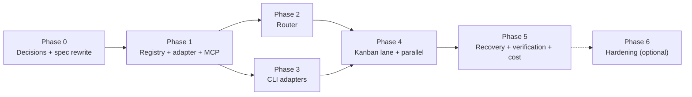

# 09 — Implementation Roadmap

**Date:** 2026-11-09 · **Status:** proposal, awaiting approval.

This replaces `phases/phase-1..6`. The six-phase plan assumed the orchestrator would build task
lifecycle, multi-account rotation, fallback, checkpointing and a verification engine. **Hermes
already ships all five.** This roadmap therefore has fewer phases, each smaller, and each
delivering something demonstrable.

---

## Principles for this roadmap

1. **One vertical slice before any horizontal layer.** Phase 1 must end with a task actually
   running through a real resource and visible in Hermes. Not a schema, not a library.
2. **Every phase ends with a runnable artifact**, not a document.
3. **Hermes's primitives are used, not reimplemented.** If Kanban does it, we do not build it.
4. **The registry is the spine.** It is built first, because everything else reads from it.
5. **No browser AI, no remote workers, no local inference.** Out of scope unless a phase says so.

---

## Phase 0 — Decisions (must happen before any code)

**Duration:** one session.
**Output:** `references/open-questions.md` answered; `specs/` rewritten; `references/decisions.md`
extended with D10+.

The twelve decisions are listed in `10_OPEN_QUESTIONS_AND_ARCHITECTURAL_DECISIONS.md`. The three
that gate everything else:

| Decision | Why it gates Phase 1 |
|---|---|
| **D-A** Integration surface (MCP + Kanban lane vs. alternatives) | Determines the shape of the MCP server and the plugin. |
| **D-D** Storage (SQLite recommended) | Determines the schema and the migration approach. |
| **D-E** Language (Python recommended) | Determines everything in the codebase. |

**Also in Phase 0 — spec corrections** (from `parts/09-spec-audit.md`):

- [ ] Rewrite `specs/architecture.md` rule 1 ("Hermes is read-only") to mean *"Hermes owns
      conversation state, memory and skills; the orchestrator never writes to them."*
- [ ] Remove the `local_model` resource type and the Ollama adapter work item.
- [ ] Restate decision D9 ("Local-first execution") as **"CLI-before-API"**.
- [ ] Replace `moonshotai/kimi-k3.1-pro` with a model ID that exists in NVIDIA's catalogue
      (verified: `moonshotai/kimi-k2.6`, `minimaxai/minimax-m3.1-flash` are present; `kimi-k3.1-pro` is not).
- [ ] Delete the "Account Manager", "Task Scheduler", "Checkpoint & Recovery" and
      "Verification Engine" components from the spec (replaced by Hermes/Kanban).
- [ ] Add the missing cross-cutting requirements: idempotency keys, concurrency limits, retry
      policy, per-task spend caps, per-provider concurrency budgets.
- [ ] Merge the three copies of the undecided list into one (`references/open-questions.md`).
- [ ] Add a date/author/status column to `references/decisions.md`.

**Completion criteria:** `specs/` and `phases/` describe a system that can be built without
further architectural decisions. No "to decide" remains that a Phase 1 developer would hit.

---

## Phase 1 — Registry + one adapter + MCP surface

**Goal:** a task runs through a real LLM API resource and comes back through Hermes.

### Work items

**1.1 Registry (the spine)**
- [ ] Pydantic models: `Resource`, `Account`, `CapabilityProfile`, `ResourceType`.
- [ ] Ordered `strength_tier` (1–10) — the field that makes "smallest capable" computable.
- [ ] `Account` split out from `Resource` (one resource, many accounts) — required by the
      already-decided "multiple API accounts".
- [ ] `auth_ref` only; a test asserts no secret value can be written to the registry.
- [ ] SQLite schema (`resource`, `account`, `account_state`) + migrations + WAL mode.
- [ ] Registry YAML loader → store, with validation errors reported clearly.

**1.2 Account isolation**
- [ ] Per-account env wrapper generator (`env:` refs, no secrets in the generated file).
- [ ] Isolation profiles per CLI: OpenCode (`XDG_CONFIG_HOME`+`XDG_DATA_HOME`, one server per
      account), Kiro (`KIRO_HOME`), Claude Code (`CLAUDE_CONFIG_DIR`), Pi, Cline.
- [ ] **Kiro is marked single-account** until two real logins are proven to isolate.

**1.3 One LLM API adapter**
- [ ] Generic OpenAI-compatible adapter (`httpx`), streaming SSE.
- [ ] NVIDIA NIM adapter (the `/v1/models` catalogue is read at registration time — the model list
      is discovered, not hard-coded).
- [ ] `health()` that does **not** make a billable call.

**1.4 MCP server**
- [ ] FastMCP server with `plan_task`, `execute_task`, `get_execution`, `list_resources`.
- [ ] `mcp_servers:` entry in `~/.hermes/config.yaml`; tools verified as callable from Hermes.

**1.5 Execution store**
- [ ] `execution`, `artifact`, `checkpoint`, `cost_ledger` tables.
- [ ] Secret redaction applied at the adapter boundary (before any event is emitted).

### Deliverable
> From Hermes: "summarize this README in 3 bullets". Hermes calls `plan_task` → sees a plan →
> calls `execute_task` → receives the answer. The execution appears in the Hermes conversation
> and in the orchestrator's SQLite store.

### Verification
- [ ] `list_resources` shows the NVIDIA resource with a correct capability profile read from
      `/v1/models`.
- [ ] A task executes via NIM, streams, and the result is in the Hermes transcript.
- [ ] The execution row has `native_session_id = null` (LLM APIs are stateless), cost recorded.
- [ ] The registry file contains no secret values (automated assertion).
- [ ] A second account for the same provider is registered and selectable.

### Risks
| Risk | Mitigation |
|---|---|
| Hermes's MCP config syntax wrong | Verify against `mcp_config.py:210` before writing. |
| Streaming through MCP not supported | Fall back to a synchronous tool result; keep the adapter's async interface internal. |

---

## Phase 2 — Router

**Goal:** the router picks the smallest capable resource, and picks a different one when the
first fails.

### Work items

**2.1 Classification**
- [ ] Task → `{domain, complexity, required_capabilities, min_tier}`.
- [ ] A **capability → minimum tier** table (e.g. `summarization` → tier 1, `code_generation` →
      tier 4, `repository_implementation` → tier 6).
- [ ] Classifier implementation: heuristic pre-filter first (cheap, no model call), model
      fallback only for ambiguous tasks. **Decision D-F** applies here.
- [ ] **Labelled evaluation set**: ~100 tasks across domains with a human-assigned expected tier.
      This is the deliverable that makes routing accuracy measurable — the spec currently has
      none.

**2.2 Selection**
- [ ] Filter: enabled, healthy, not cooling down, `strength_tier >= min_tier`, capability match.
- [ ] Score by cost → latency → tier (cheapest *that clears the bar*).
- [ ] Explainability: every plan states *why* this resource was chosen and what was rejected.

**2.3 Health and fallback**
- [ ] `account_state` updates from adapter responses: 429 → cooldown to the provider's reset;
      402 → cooldown + surface; 401 → refresh then disable; 5xx → backoff.
- [ ] Re-plan on failure → escalate to the next tier, bounded by `max_escalations` and the
      per-task spend cap.
- [ ] **LLM-API account rotation delegates to Hermes's credential pools** — do not reimplement.

### Deliverable
> "Classify this paragraph" → tier-1 model, cheapest available, plan shown with reasoning.
> "Implement a rate limiter in this repo" → tier-6 coding resource, not the tier-1 model.

### Verification
- [ ] Routing accuracy on the labelled set ≥ an agreed threshold (decide the threshold; suggest
      85% on tier selection).
- [ ] A deliberately under-powered resource is rejected for a tier-6 task.
- [ ] A 429 on the chosen account causes a re-plan to a healthy account, and the escalation is
      recorded.
- [ ] The router never exceeds the per-task spend cap.

### Risks
| Risk | Mitigation |
|---|---|
| A model-based classifier adds latency + cost to every task | Heuristic first; model only for ambiguous tasks; measure the ambiguous rate. |
| No ground truth for "correct routing" | The labelled set + verification verdict as the success oracle. |

---

## Phase 3 — Coding CLI adapters

**Goal:** the orchestrator can drive a real coding CLI, with resume.

### Work items

**3.1 OpenCode adapter (first — best interface)**
- [ ] Prefer `opencode serve` (HTTP + SSE) over shelling out; fall back to `opencode run --format json`.
- [ ] Session create → prompt → stream → session id → resume (`--session`).
- [ ] One server instance per account.

**3.2 Kiro adapter**
- [ ] `kiro-cli chat --no-interactive --output-format stream-json`.
- [ ] Capture `--resume-id` for resume.
- [ ] `--trust-all-tools` / `--trust-tools` mapping to the trust policy.

**3.3 Claude Code adapter**
- [ ] `claude -p --output-format stream-json`; `CLAUDE_CONFIG_DIR` isolation; `--resume`.

**3.4 Generic subprocess adapter**
- [ ] A reusable adapter for Pi and Cline driven by their JSON modes, so adding a CLI is ~100
      lines rather than a new class.

**3.5 Process management**
- [ ] `start_new_session=True` → process group → signal the whole tree on cancel.
- [ ] Timeouts, cancellation, and capture of exit codes.

### Deliverable
> "Fix the failing test in <repo>" → the orchestrator picks OpenCode, runs it in a Kanban
> workspace, streams progress into the Hermes conversation, and returns the changed files plus the
> native session id so it can be resumed.

### Verification
- [ ] A real task modifies a file, and the diff is captured as an artifact with a sha256.
- [ ] The native session id is recorded, and a second invocation resumes that session.
- [ ] Killing the orchestrator mid-run and restarting resumes the task (restart-recovery test).
- [ ] Cancelling terminates the whole process group — no orphaned CLI processes.

### Risks
| Risk | Mitigation |
|---|---|
| CLI output formats differ per tool | The adapter normalises to `ExecutionEvent`; fixtures per tool. |
| A CLI hangs | Timeout → SIGINT → SIGTERM → SIGKILL, then re-plan. |
| Cline's `--json` cannot resume (known bug) | Document Cline as no-resume until fixed upstream. |

---

## Phase 4 — Kanban lane + long-running work

**Goal:** multi-minute tasks run through Kanban with workspaces, parallel workers and review.

### Work items

**4.1 The lane plugin**
- [ ] `~/.hermes/plugins/orchestrator-lane/` — `plugin.yaml` + a `spawn_fn` that calls the
      orchestrator's internal endpoint.
- [ ] The worker ends with exactly one of `kanban_complete` / `kanban_request_review` / `kanban_block`.

**4.2 Workspace discipline**
- [ ] Require a workspace; refuse dispatch outside the board's workspace root.
- [ ] Git worktree isolation per card (reference: T3 Code's worktree module) — optional but
      recommended for parallel code tasks.

**4.3 Parallelism**
- [ ] Global and per-provider concurrency limits (the spec has none).
- [ ] Per-workspace lock so two cards cannot write the same tree.

**4.4 Idempotency**
- [ ] Every dispatch carries an idempotency key; duplicates rejected.

### Deliverable
> Three independent cards fan out to three coding CLIs in three workspaces, run in parallel, and
> land in review.

### Verification
- [ ] Three cards run concurrently and finish within the expected wall-clock.
- [ ] A duplicate dispatch with the same idempotency key does not re-run.
- [ ] A card's worker crash is reaped by Kanban (`crashed` event), not left running.
- [ ] The concurrency limit is enforced (attempt N+1 is queued, not started).

---

## Phase 5 — Recovery, verification, cost

**Goal:** nothing is lost when things break, and spend is visible.

### Work items

**5.1 Restart recovery**
- [ ] On startup, find `status='running'` rows older than the stale threshold → requeue with the
      stored native session id.
- [ ] Checkpoint on phase events and on a 30 s timer.

**5.2 Verification (adapter-level, not a new engine)**
- [ ] Per-adapter verification: exit code, declared test command, lint/type-check if the task
      type warrants it, output schema validation for structured outputs.
- [ ] **Semantic judgment belongs to Kanban's reviewer** (`kanban_request_review` → the bundled
      `sdlc-review` skill), not to a bespoke engine.
- [ ] Which checks are mandatory per task type — **decision D-H**.

**5.3 Cost and usage**
- [ ] Cost ledger populated per execution and per account.
- [ ] Per-task spend cap enforced (hard stop, not a warning).
- [ ] `hermes` can query spend through the MCP server.

### Deliverable
> Kill the orchestrator mid-task → restart → the task resumes from its checkpoint and finishes.
> Ask Hermes "what did that cost?" → a number, broken down by account.

### Verification
- [ ] Kill -9 during a task, restart, task resumes and completes.
- [ ] A task that exceeds its spend cap stops before the next call.
- [ ] Kanban's reviewer rejects a bad implementation and the task is reworked.
- [ ] The cost ledger reconciles with the provider's own usage report for a test task.

---

## Phase 6 — Hardening (optional, time permitting)

- [ ] **Remote workers** — only if a second machine is genuinely needed. herdr-core's
      `machine.add` (SSH) + `machine.exec` is the reference.
- [ ] **herdr-core adapter** — a generic "durable PTY" adapter for tools with no structured mode.
- [ ] **Model-quality routing** — use the verification verdict as a training signal to tune the
      tier mapping over time.
- [ ] **Browser AI** — only with a fresh decision, and only under the constraints in
      `07_SECURITY_AND_ACCOUNT_MANAGEMENT.md`.

---

## Effort estimate

| Phase | Rough size | Notes |
|---|---|---|
| 0 — Decisions | 1 session | Mostly rewriting the spec. |
| 1 — Registry + adapter + MCP | ~1,200 lines | The spine. |
| 2 — Router | ~600 lines + a labelled dataset | The dataset is the real work. |
| 3 — CLI adapters | ~900 lines | ~150 lines per CLI once the generic adapter exists. |
| 4 — Kanban lane | ~400 lines | The lane plugin is ~100 lines; the rest is workspace + concurrency discipline. |
| 5 — Recovery + verification + cost | ~600 lines | |
| **Total** | **~3,700 lines** | Versus the original spec's implied 8-component, 6-phase engine. |

The reduction comes almost entirely from delegating task lifecycle to Hermes.

---

## Dependencies between phases

Phase 2 and Phase 3 are independent after Phase 1 and can run in parallel.

---

## What is explicitly NOT in this roadmap

| Excluded | Why |
|---|---|
| Browser AI | ToS + security exposure + no upside for the API-capable providers. |
| Local model serving | Forbidden by the brief; Ollama is not even installed. |
| A remote-worker fleet | No demonstrated need; one machine today. |
| An API gateway (LiteLLM) | Hermes already rotates and fails over; LiteLLM's enterprise terms restrict production use. |
| A bespoke task scheduler | Kanban owns it. |
| A bespoke verification engine | Kanban's review loop owns it. |
| A bespoke account manager | Hermes credential pools own key rotation. |
| Multi-tenant support | Single user. |
| A metrics server | The SQLite ledger is enough. |
